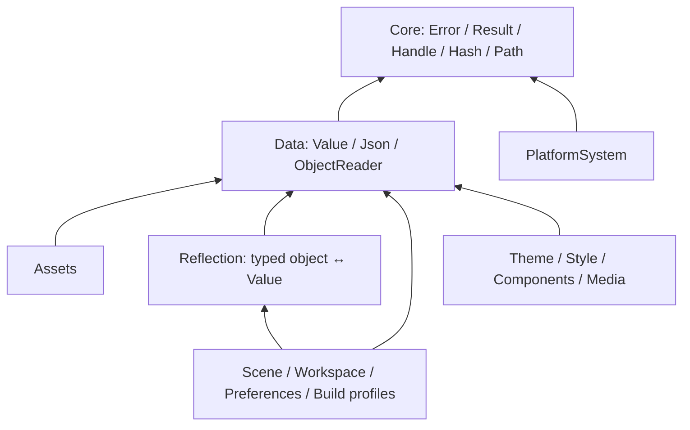

# 公共基础与数据契约

工程现在有独立的 `core/` 基础库，公开目标为 `ShinkouEngine::Core`，使用 C++17。
它承载跨模块共用的错误/结果、通用值树、JSON 编解码、字段读取、句柄编码、
UTF-8 路径边界和哈希基础。编辑器、资产、平台后端使用同一份实现。



Core 不依赖 Engine、World、UI、renderer、平台后端或日志。JSON 实现依赖固定版本
nlohmann/json 3.12.0，只在 `core/src/Json.cpp` 私有编译；公共头文件不会传播该依赖。
资产项目可以独立构建，自动添加 Core，无需链接主引擎。

## 公共 API

| 头文件 | 约定与用途 |
| --- | --- |
| `shinkou/core/Error.h` | 可移植错误码、原生错误码、消息、字节偏移和上下文路径 |
| `shinkou/core/Result.h` | `Result<T>` / `Status`，支持移动类型，显式区分值和失败 |
| `shinkou/core/Handle.h` | 带类型标签的代次句柄，以及保留零值的打包句柄编码 |
| `shinkou/core/Hash.h` | 字节/字符串哈希及明确命名的历史 seed |
| `shinkou/core/Path.h` | 原生 filesystem path 与 UTF-8 通用路径字符串转换 |
| `shinkou/data/Value.h` | Null、Boolean、精确整数、浮点、String、Array、Object 的值树 |
| `shinkou/data/Json.h` | 唯一 JSON codec、资源预算、诊断、schema/version 头 |
| `shinkou/data/Read.h` | 检查范围和类型的转换、可选/必填字段读取、JSON Pointer 诊断 |

`Value` 使用 `std::variant`，不会为每个节点同时保存所有标量和容器。
`int64_t`、`uint64_t` 和 double 分开保存；资产 ID、哈希与枚举不再经 double 中转。
Object 使用确定性键顺序，Array 保持元素顺序。配置、持久化和工具交互使用值树；
ECS chunk、顶点、音频和渲染提交继续使用各自的连续原生数据结构。

```cpp
#include "shinkou/data/Json.h"
#include "shinkou/data/Read.h"

shinkou::core::Result<float> read_gain(std::string_view text) {
    auto parsed = shinkou::data::parse_json(text);
    if (!parsed) return parsed.error();
    float gain = 1.0f;
    shinkou::data::ObjectReader reader(*parsed);
    reader.read("gain", gain); // 缺省保留默认值，存在但类型错误会失败。
    if (!reader) return reader.error();
    return gain;
}
```

ObjectReader 保留首个错误，读取失败不修改该字段；复杂 DTO 应先读入临时对象，
验证完成后再发布。`parse_json(input, output)`、通用 JSON writer 和反射序列化输出
采用成功后提交的方式。反射 `deserialize_value` 按元数据写入调用方对象；要求
整体回滚的调用方应像场景/偏好现有实现一样，先构造临时 DTO。

## 已迁移的链路

| 模块 | 现在复用的实现 |
| --- | --- |
| 平台文件、线程、内存、进程、动态库等后端 | `platform::Result/SystemError/ErrorCode` 是 Core 类型的兼容别名 |
| 资产 manifest | 通用值树、严格 JSON、精确 uint64、共享转义与 UTF-8 路径边界 |
| 反射、场景、偏好、工作区、资产设置 | `typed object ↔ Value ↔ JSON`，解析与编码从类型遍历中拆出 |
| glTF 预览 | 同一 SAX codec；保留 glTF 字段、外部资源和数组上限等领域验证 |
| compile_commands | 同一 codec；保留命令行拆分、项目边界与路径检查 |
| 构建 profile/profile set | 同一 codec；保留程序/参数白名单与项目范围检查 |
| Dock 布局 | 同一 codec；保留树约束、ID 唯一性与版本检查 |
| Theme、ThemeRegistry、Style | 同一值树与 writer；颜色/字体等校验留在 UI 领域 |
| Components、Media | 同一值树与检查型标量转换；保留组件和媒体 DTO |
| profiler 与 renderer diagnostics 导出 | 同一 JSON 字符串编码 |
| Entity 与音频句柄 | Core 代次/打包编码，保持原字段和位布局 |
| 反射名称、资产与媒体预览指纹 | 共享哈希基础，保持各自原 seed 和组合语义 |

原先九份私有 JSON parser/DOM 已删除，Style 的全文搜索式 JSON 读取也已移除。
这九个主要消费者相比迁移前快照减少约 2730 行。Core 新增的是共享实现和公共契约，
没有给每个模块再复制一份适配器。

## 文件和输入约定

- JSON 是 UTF-8；重复键、无效 Unicode、非有限浮点和超过 64 位范围的整数会失败。
- 默认预算：输入 16 MiB、深度 64、节点 1000000、字符串 1 MiB、单数组 500000 项、
  单对象 65536 个成员。glTF、manifest、构建 profile 等使用各自更合适的预算。
  解码与编码均有 256 层的硬深度上限。
- 语法错误提供零基字节偏移；值树路径使用 JSON Pointer 转义。字段转换错误提供
  `/background/opacity` 等路径，范围错误不会进行溢出转换。
- 浮点输出使用 locale-independent `to_chars`。模块通过 `Value` 构建文档，
  再交给公共 writer；不再实现 JSON lexer 或字符串转义。
- 新的项目自有文档可用 `data::document({schema,version})` 和
  `validate_document()` 维护统一头。现有文件字段与版本继续兼容。
  glTF、compile_commands 等外部标准格式遵循其自己的 schema。
- 持久化路径通过 `path_to_utf8` / `path_from_utf8` 转换。它们只处理编码与分隔符；
  项目根边界、符号链接、URI 和访问权限仍由文件系统/资源领域负责。

现有合法文件保持可读，JSON 的空白和对象字段顺序可能改变。依赖重复键覆盖、
非法字节或整数精度损失的输入会被拒绝。资产 ID 和反射名称的哈希值保持不变，
音频句柄的位编码及 Entity 的 id/generation 布局保持不变。

这是一次 C++ 源码层迁移：公共平台错误增加了定位信息，Entity 改为模板实例别名，
原有二进制插件应随引擎完整重编译。GPU 描述符、物理 body、逻辑/物理像素矩形等
类型继续保留各自的单位、归属与有效性语义。

## 构建与测试

```cmake
target_link_libraries(game PRIVATE ShinkouEngine::Core)
```

```powershell
cmake -S core -B out/build/core-debug -DCMAKE_BUILD_TYPE=Debug
cmake --build out/build/core-debug
ctest --test-dir out/build/core-debug --output-on-failure
```

根工程的测试断言规则现在自动应用到全部 `shinkou_*_tests` 目标；Release 也保留
测试准备和检查调用，避免新测试漏进手工名单。MinGW 的 AVX2 测试兼容规则继续保留。
Core 测试使用独立检查函数，Assets 自身也保留独立构建和测试入口。

核心契约测试包括整数边界、移动结果、句柄编码、固定哈希向量、UTF-8 路径、
Unicode/重复键、深度/节点/输入输出预算、类型转换、错误路径与进程 locale 独立性。
领域回归覆盖反射值树往返、64 位枚举、场景/偏好、主题/样式、glTF、资产 manifest、
编译数据库以及原生平台接口。

## 本次验证记录

2026-11-02，Windows x64 / MinGW：

- `runtime-release` 全量构建完成，CTest **82/82 通过**，31.28 秒。
  此配置关闭 ImGui 与 PhysX，本次结果不代表其可选后端已完成集成验证。
- 独立 Core 的 Release、Debug 测试通过；独立 Assets 构建的 2 项测试通过。
- 数学并行测试连续 50 轮通过；每轮覆盖所有参与线程同时提交嵌套任务、
  1000 次小任务完成竞争以及异常传播。另以 `-O0 -g` 构建并运行同一测试，通过。
- 回归发现并修复了数学执行器的完成通知丢失窗口；等待线程现在协助消费队列，
  防止所有工作线程进入嵌套调用后互相等待。发布队列指针前先预留容量，
  避免分配异常留下指向提交者栈内任务的悬空项。
- 现有数学基准：1048576 点、20 轮、8 个工作线程，数值 checksum 为 0。
  本机单次测量：标量 363、SIMD 739、并行 1569、并行 SoA 2111 Mpoints/s。
  这是当前构建的测量记录，没有据此声称相对迁移前的性能提升。
