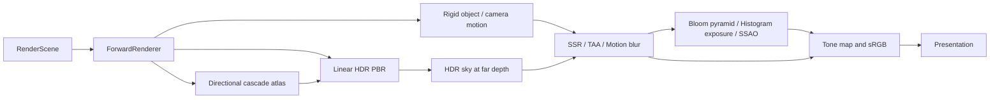

# Rendering interface boundary

The engine has one upper-level rendering contract:

`Renderer -> RenderGraph -> IRenderBackend -> native backend implementation`

Gameplay, editor features, samples, and tools use `Renderer`, `RenderGraph`,
resource descriptors, capabilities, and the common draw/dispatch commands.
DX11, DX12, and Vulkan objects remain implementation details of
`engine/src/render/backends/`. `Backends.cpp` only selects the backend.
`Renderer` intentionally does not expose a
backend pointer; use `Renderer::execute_graph()` for an explicitly supplied
graph and `Renderer::submit()` for the owned frame graph.

Backend differences that affect feature selection must be reported as
capabilities, not tested through `BackendApi` in feature code. For example,
editor model rendering uses `supportsEditorModelRendering`. `BackendApi` is
still valid for backend selection, diagnostics, and shader-asset compilation
inside the rendering implementation.

## Pipeline composition

`StandardRenderPipeline` owns the default forward path, HDR and depth targets,
the directional shadow atlas, motion target, built-in image programs, and separate
TAA/exposure histories.
The sample uses this entry point in standalone mode. Editor UI retains its
existing viewport and overlay submission boundary.

`StandardRenderPipelineDesc::stages` and `set_stages()` accept an authored, named
sequence including geometry and image stages. `$color` follows the preceding
color replacement; explicit sources, extra inputs and named dependencies form
the resource contract. Custom instances resolve executors by name before kind.
Stage boundaries are explicit graph edges, including expanded subgraphs and
side-effect-only passes. They constrain submission, recording and queue waits.
Within a stage, its own resource graph governs internal ordering.

Applications pass real frame seconds to `build()` and call
`complete_frame(success)` after submission. Failed frames
invalidate temporal feedback. Successful frames commit previous object/camera
transforms and ping-pong histories. Camera cuts and stage changes invalidate
history; jitter is applied consistently to scene and motion projections.
Background motion uses directions at infinity, removing camera translation.
Sky is an explicit HDR stage with caller-owned equirectangular textures or a
linear gradient, depth testing at the far plane and no depth writes.
Resize replaces working targets only after new
targets have been allocated; it is rejected while a built frame is pending.

For custom pipelines, compose `PbrMaterialLibrary`, `MotionVectorRenderer`, `BuiltinRenderFeatures`,
`ForwardRenderer` and `RenderFeatureGraphBuilder` directly. `plan()` describes
resources and stages without registering fake draw callbacks. `build()` requires
an implementation for every enabled stage and commits only a compiled graph.
Typed vertex layouts, streams, instances, blend/depth/stencil/rasterizer states
are part of the common `PipelineDesc` contract and pipeline cache identity.

## Recording and resource ownership

A pass can supply `RenderGraph::RecordCallback`. It appends value commands to
`RenderCommandList`; the scheduler may record independent passes on workers.
The graph validates command resources before creating transient GPU resources,
then replays packets in graph submission order. Native device operations and
legacy backend callbacks execute on the submission thread. This does not provide
parallel native command buffers or multiple GPU frames in flight.

Uninitialized transient textures use a bounded native reuse cache. Resources
with initial data cannot alias because uploads currently happen before all
passes. Enabling aliasing for them requires an explicit first-use upload model.
Persistent CPU-visible buffer writes wait for previous GPU readers. Full frame
overlap requires versioned buffers, descriptor ownership and per-frame command
allocators rather than removing those waits.

Exposure may expand into compute histogram clear/build passes followed by a
graphics percentile resolve. Both graphs and native APIs preserve repeated
storage-write dependencies; unchanged UAV state still requires a memory barrier.
The histogram uses group-local counts before global atomics and reads every
source pixel. Compute-less devices reject histogram metering explicitly.

See `RenderingImplementation.md` for validation evidence and remaining limits.

## Common line geometry

`shinkou/render/RenderGeometry.h` provides the backend-neutral line primitive
and indexed line-list builder. `append_line_segment()` is the allocation-free
hot-path after the caller reserves storage; it rejects non-finite,
scale-degenerate segments and protects the 32-bit index range. The resulting
positions use tightly packed `Vec3` values and can be uploaded through the
normal `BufferDesc`/`MeshDraw` path with a line-topology pipeline.
